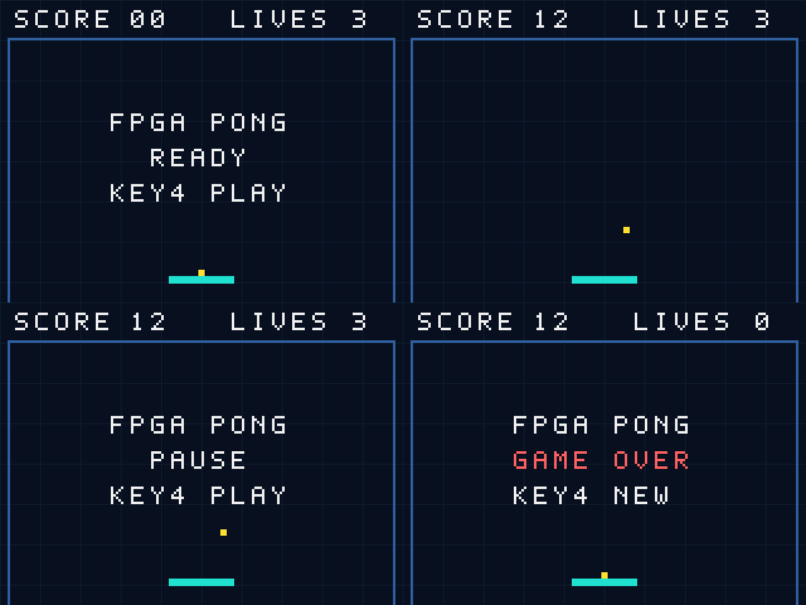
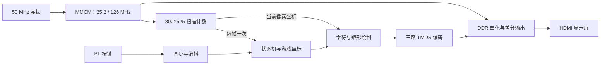
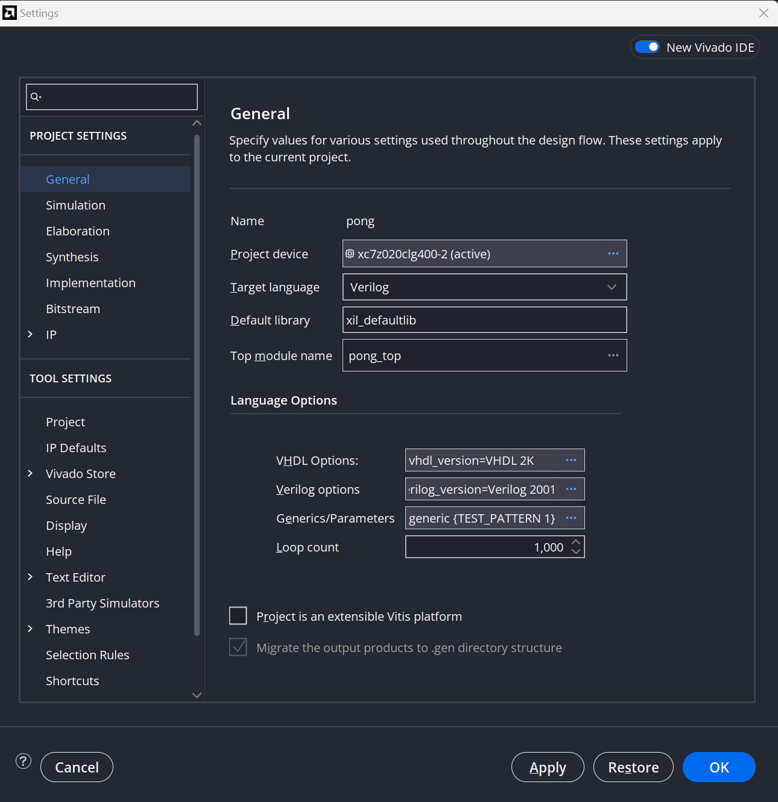
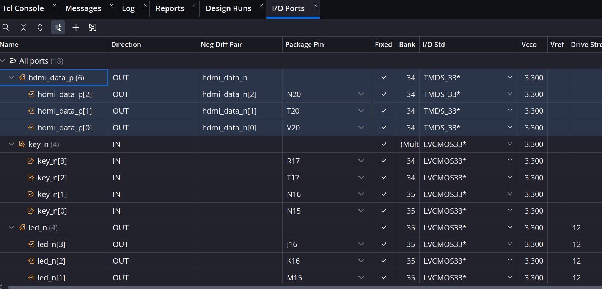
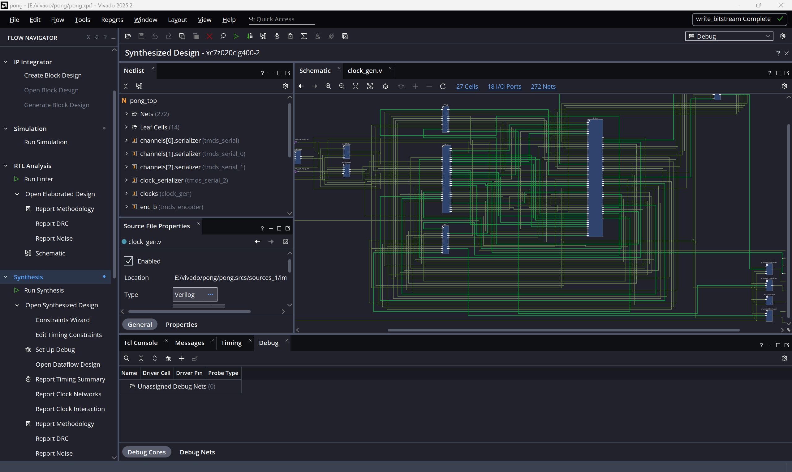
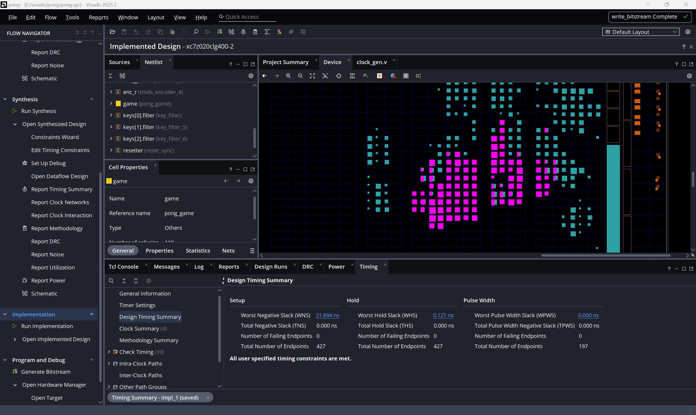
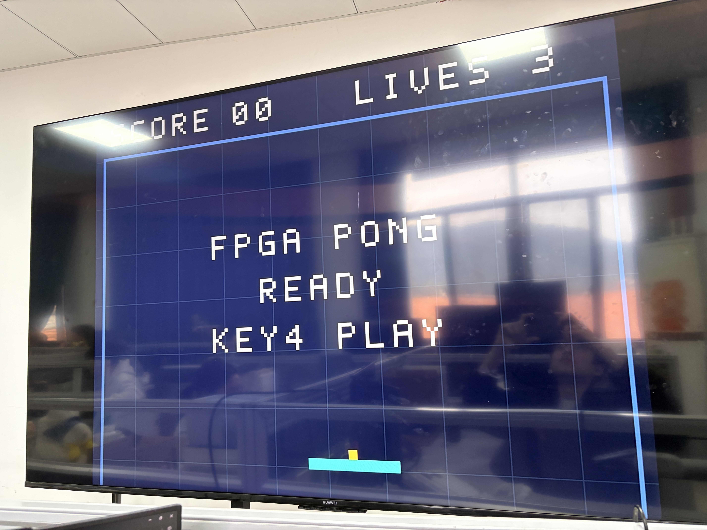

# AX7020 纯 FPGA 进阶入门实验：HDMI 挡板接球游戏

> 任务：只用 AX7020、HDMI 显示屏及连接线，制作一个能实际游玩的单人挡板接球游戏。屏幕显示球、挡板、分数和 3 次机会；用板载按键移动、开始、暂停，漏接 3 次进入 GAME OVER。

## 1. 项目操作

### 1.1 操作规则

 **PL KEY1～PL KEY4**

| 按键 | 功能 | 屏幕反应 |
| --- | --- | --- |
| KEY1 | 整体复位，包括视频时钟模块 | 屏幕可能短暂重新锁定，回到 READY，分数 00、机会 3 |
| KEY2，按住 | 挡板左移 | 每帧移动 7 像素，到边界停止 |
| KEY3，按住 | 挡板右移 | 每帧移动 7 像素，到边界停止 |
| KEY2＋KEY3 同时按住 | 不移动 | 两个方向互相抵消 |
| KEY4，在 READY | 发球 | 进入 RUN，球开始运动 |
| KEY4，在 RUN / PAUSE | 暂停 / 继续 | 位置保持 / 恢复运动 |
| KEY4，在 GAME OVER | 新一局 | 回到 READY，再按一次才发球 |

球碰左右边界、上边界反弹；向下穿过挡板顶面并与挡板重叠时反弹，得分加 1。得分到 99 后保持 99。漏接后机会减 1，若仍有机会就回到 READY，保留累计分数；机会归零进入 GAME OVER。

没有“随机胜利”或隐藏输入：一次明确的验收任务是 **接住球累计得 10 分，演示暂停和继续，随后演示三次漏接及重开**。新手可先以接住 1 次为目标。

### 1.2 LED 辅助诊断

| 指示灯 | 点亮含义 |
| --- | --- |
| PL LED1 | 视频 MMCM 已锁定 |
| PL LED2 | 处于 PAUSE |
| PL LED3 | 最近接到球，约保持 10 帧，即 0.167 秒 |
| PL LED4 | GAME OVER |

LED 仍然低电平点亮。游戏内部使用正逻辑，最后在顶层取反输出，避免到处混用“0 表示亮”的含义。

### 1.3 画面参考

下图由 **实际 `video_render.v` 经 XSim 输出 RGB 后生成**。四幅依次为 READY、RUN、PAUSE、GAME OVER


## 2. 文件清单

| 文件 | 职责 | 建议阅读顺序 |
| --- | --- | --- |
| [rtl/pong_game.v](rtl/pong_game.v) | 游戏状态机、运动、碰撞、分数和机会 | 1，先理解规则怎样成为寄存器和条件判断 |
| [rtl/key_filter.v](rtl/key_filter.v) | 异步输入同步、10 ms 消抖、单次按下事件 | 2 |
| [rtl/video_timing.v](rtl/video_timing.v) | 逐行扫描计数、同步信号、每帧更新脉冲 | 3 |
| [rtl/video_render.v](rtl/video_render.v) | 根据坐标直接算颜色、字符点阵 ROM、彩条模式 | 4 |
| [rtl/pong_top.v](rtl/pong_top.v) | 模块连接和三路并行颜色通道 | 5 |
| [rtl/reset_sync.v](rtl/reset_sync.v) | 异步置位、同步释放复位 | 配合按键模块 |
| [rtl/clock_gen.v](rtl/clock_gen.v) | MMCM 与时钟缓冲：25.2 MHz、126 MHz | 先使用，再理解 |
| [rtl/tmds_encoder.v](rtl/tmds_encoder.v) | RGB 8 位数据编码为 10 位视频符号 | 先使用，再理解 |
| [rtl/tmds_serial.v](rtl/tmds_serial.v) | 7 系列 OSERDESE2 主从串化 | 先使用，再理解 |
| |

## 3. 架构



|  |  | |
| --- | --- | --- |
| 并行模块与 `always` | 扫描、按键、游戏、RGB 编码在各自电路中同时工作 | 主状态机 PAUSE 时，像素时序和编码仍持续运行，否则屏幕会失去信号 |
| 非阻塞赋值 `<=` | 保存坐标、状态、同步链与计数器 | 同一时钟沿读取旧寄存器值，完成后统一更新，不是每写一行就立即改变后续读值 |
| 组合逻辑 `always @*` | 根据旧位置计算下一位置、根据像素坐标算颜色 | 必须给默认值，避免意外推断锁存器 |
| 位拼接与逐位运算 | 复位移位链、TMDS XOR/XNOR、LED 输出取反 | 运算直接对应并行位逻辑 |
| `generate` | 实例化 3 个消抖器、3 路数据串化器 | 在综合展开时复制硬件，不是运行时循环调用一个共享函数 |
| 参数 | `TEST_PATTERN` 选择彩条/游戏，消抖周期可缩短仿真 | 参数是展开和综合配置，改后要重新生成比特流 |
| 字符 ROM 与坐标比较 | 按每个像素的位置决定显示内容 | 不需要 CPU 逐个执行画图指令，也不必保存整幅帧图 |

### 3.1 为什么按键不会漏、也不会长按反复暂停

物理按键先经过两级寄存器同步，再要求电平连续稳定 252000 个像素时钟，即 10 ms，才改变稳定状态。KEY2/KEY3使用稳定电平用于连续移动；KEY4使用只有一个时钟周期的 `press` 脉冲。

一帧有 420000 个像素时钟，KEY4 的脉冲未必刚好出现在帧更新点。因此 `action_pending` 寄存器把事件保存到下一帧再处理。按住 KEY4 不会每帧暂停、继续来回切换，必须先松开、再按一次。

KEY1 是独立的整体复位：它先复位 MMCM，MMCM 的 LOCKED 失效后请求逻辑复位。锁定恢复后，`reset_sync` 再等待两个像素时钟沿释放复位。这样即使像素时钟暂时停止，失锁也能异步复位；同时避免把多个异步信号简单组合后接到整片逻辑的复位端。

### 3.2 为什么不会画面“撕裂”

所有球和挡板坐标在每帧的垂直消隐区开始附近更新一次，在当前可见区域扫描期间保持稳定。屏幕逐行输出时使用的是同一组坐标，不会画到一半突然改变球的位置。

它不是双缓冲：本实验根本没有存整帧图像，而是用坐标比较和字符位图直接生成当前像素的颜色。

### 3.3 状态机参考

| 当前状态 | KEY4 事件 | 无事件时的行为 |
| --- | --- | --- |
| READY | RUN | 挡板可移动，球贴在挡板上方等待发球 |
| RUN | PAUSE | 每帧运动、碰撞、计分；漏接后 READY 或 OVER |
| PAUSE | RUN | 游戏位置冻结，视频持续输出 |
| OVER | READY，清分并恢复机会 | 保持最终分数与 GAME OVER |

按键事件优先于当前帧的物理运动，所以暂停、继续或发球的那一帧不会同时额外移动球。

## 5. 视频输出

### 5.1 分辨率与时钟

| 项目 | 水平 | 垂直 |
| --- | --- | --- |
| 可见区域 | 640 像素 | 480 行 |
| 前肩 | 16 像素 | 10 行 |
| 同步脉冲 | 96 像素，低有效 | 2 行，低有效 |
| 后肩 | 48 像素 | 33 行 |
| 合计 | 800 像素 | 525 行 |

使用 25.2 MHz 像素时钟：`25,200,000 / (800 × 525) = 60 Hz`。640×480 常见标称时钟是 25.175 MHz，这里采用接近且可准确分频的 25.2 MHz。

MMCM 的参数关系：`50 MHz / 5 × 63 = 630 MHz VCO`，再分别除以 25 和 5，得到 25.2 MHz 与 126 MHz。它们同源且频率比为 1:5，不是两个互不相关的时钟。


## 6. 硬件、引脚和约束的意义

### 6.1 在 I/O Planning 中填写的完整表格

| Port | Package Pin | I/O Standard | 功能 |
| --- | --- | --- | --- |
| `sys_clk` | U18 | LVCMOS33 | 50 MHz 输入 |
| `key_n[0]` | N15 | LVCMOS33 | PL KEY1，复位 |
| `key_n[1]` | N16 | LVCMOS33 | PL KEY2，左移 |
| `key_n[2]` | T17 | LVCMOS33 | PL KEY3，右移 |
| `key_n[3]` | R17 | LVCMOS33 | PL KEY4，动作 |
| `led_n[0]` | M14 | LVCMOS33 | PL LED1，锁定 |
| `led_n[1]` | M15 | LVCMOS33 | PL LED2，暂停 |
| `led_n[2]` | K16 | LVCMOS33 | PL LED3，接球 |
| `led_n[3]` | J16 | LVCMOS33 | PL LED4，结束 |
| `hdmi_clk_p` | N18 | TMDS_33 | 视频时钟正端 |
| `hdmi_clk_n` | P19 | TMDS_33 | 视频时钟负端 |
| `hdmi_data_p[0]` | V20 | TMDS_33 | 蓝通道正端 |
| `hdmi_data_n[0]` | W20 | TMDS_33 | 蓝通道负端 |
| `hdmi_data_p[1]` | T20 | TMDS_33 | 绿通道正端 |
| `hdmi_data_n[1]` | U20 | TMDS_33 | 绿通道负端 |
| `hdmi_data_p[2]` | N20 | TMDS_33 | 红通道正端 |
| `hdmi_data_n[2]` | P20 | TMDS_33 | 红通道负端 |
| `hdmi_out_en` | V16 | LVCMOS33 | 输出端 5 V 使能 |

共 18 个端口位。P/N 不能交换；TMDS_33 与普通按键的 LVCMOS33 也不能混填。

## 7. 实验步骤

### 7.1 新建工程并添加源文件

1. Vivado → **Create Project**，工程名 `ax7020_pong`，放到新的英文路径，避免覆盖原 `E:/vivado/led`。
2. 选 **RTL Project**，勾选暂不指定源文件；Default Part 选择 `xc7z020clg400-2`，完成向导。
3. **Add Sources → Add or create design sources → Add Files**，选本实验 `rtl` 下全部 9 个 `.v`。勾选 Copy Sources into Project 后，要记住以后编辑的是工程里的副本。
4. Design Sources 中右键 `pong_top` → **Set as Top**。不要把 Testbench 当成综合顶层。



### 7.2 交互设置管脚并保存

1. **RTL Analysis → Open Elaborated Design**。
2. Layout 下拉选择 **I/O Planning**，若没有表格，打开 **Window → I/O Ports**。
3. 展开总线，在 Package Pin 与 I/O Std 列逐项填写第 6.2 节表格。使用差分原语后，一些界面会联动显示互补管脚，仍需核对两端。
4. 使用 **File → Constraints → Save**，首次提示保存时命名 `ax7020_pong.xdc`，放在工程默认约束目录，加入 `constrs_1`。

把视频信号接到真实 HDMI 连接器，并配置正确的差分电气标准。



### 7.3 用时序窗口设置输入时钟和按键异步路径

1. 先 **Run Synthesis → Open Synthesized Design**。交互时序窗口只在综合后或实现后设计可用，因此这里先运行一次综合来打开它。
2. **Window → Timing Constraints**，在 **Clocks → Create Clock** 打开创建窗口。
3. 名称填 `sys_clk`；用浏览按钮选择顶层输入端口 `sys_clk`；Period 填 **20.000 ns**，Rise 0.000，Fall 10.000，确认。
4. 若窗口中已经有同一输入时钟，核对即可，不重复添加。不要创建没有源端口的虚拟时钟。
5. 在时序约束类别中选择 **Set False Path**，打开对话框。只在 **From** 中通过对象浏览器选择 4 个原始输入端口 `key_n[0]`～`key_n[3]`；其余筛选项保持空，确认。选择的是原始输入端口，不是所有寄存器，也不是所有时钟。
6. 使用 **Apply**（若出现），再 **File → Constraints → Save**，保存到当前目标 XDC。
7. 关闭设计视图，重新运行综合，让完整约束参与综合优化。

得到以下约束：
```
create_clock -period 20.000 -name sys_clk -waveform {0.000 10.000} [get_ports -filter { NAME =~  "*sys_clk*" && DIRECTION == "IN" }]
set_false_path -from [get_ports *key_n*]
```


### 7.4 实现

1. **Run Implementation → Open Implemented Design**，查看 Timing Summary、DRC 和 Clock 报告。
2. 确认像素时钟约 25.2 MHz、串化时钟约 126 MHz；检查 Setup/Hold，不能只看流程完成状态。
3. **Generate Bitstream**，成功后记录 `.bit` 路径。GUI 工程通常为 `ax7020_pong.runs/impl_1/pong_top.bit`。
4. 断电设置 J13 为丝印 JTAG 对应针脚。连接外部 5 V 电源、USB-JTAG，并用 HDMI 线将板卡 HDMI 接到显示屏输入；不要连接笔记本 HDMI 输出。
5. 显示屏开机并选对输入源，开发板上电。
6. **Open Hardware Manager → Open target → Auto Connect → Program Device**，选择本次 `.bit`。本实验未插入 ILA，不需要 `.ltx`。


## 8. 测试游戏

1. 看到 READY、SCORE 00、LIVES 3 后，按 KEY2/KEY3 试移动挡板。
2. 按 KEY4 发球。移动挡板接住下降的球，确认分数增加、LED3 短亮。
3. 按一次 KEY4 暂停，保持按住数秒，确认不会反复切换；松开并再按一次继续。
4. 累积到 10 分并拍摄；再演示漏接。每次漏接后，仍有机会时需按 KEY4 重新发球。
5. 漏接三次后显示 GAME OVER、LIVES 0，LED4 亮。按 KEY4 开新局，再按发球；KEY1 则任何时候都可整体复位。

## 9. 学习问答：从 Verilog 到实际电路

### 9.1 组合逻辑、时序逻辑、阻塞与非阻塞赋值有什么区别？

**组合逻辑负责计算，时序逻辑负责保存状态。** 本项目通常“组合块用 `=`，时钟块用 `<=`”。

| 概念 | 含义 | Pong 例子 |
| --- | --- | --- |
| 组合逻辑 | 结果随输入变化，经过传播延迟后稳定 | 下一位置、碰撞、像素颜色 |
| 时序逻辑 | 保存状态，主要在时钟沿更新 | 坐标、分数、生命 |
| 阻塞赋值 `=` | 同一过程内，后面立即读到新值 | 先算候选位置，再判断是否越界 |
| 非阻塞赋值 `<=` | 执行时计算右侧，稍后统一更新左侧 | 寄存器按更新前的数据计算新值 |

```verilog
// 组合块：先计算，再修正。
bx_next = ball_x + 4;
if (bx_next > RIGHT-BALL) bx_next = RIGHT-BALL;

// 时钟块：到允许更新的时钟沿，保存结果。
if (frame_tick) ball_x <= bx_next;
```

非阻塞赋值的“旧值”例子：

```verilog
lives <= lives - 1'b1;
if (lives == 1) state <= OVER;
```

判断用的是扣减前的生命数：原来为 1，这次扣到 0 并结束。`<=` 在当前仿真时刻的非阻塞更新阶段生效，不代表必须再等一拍。

- `frame_tick` 是使能，不是时钟；没有更新时，位置寄存器保持原值。
- `reg` 不保证生成寄存器，例如 `video_render` 的 RGB 仍是组合逻辑。
- 组合块应覆盖全部赋值路径，避免意外锁存器；时钟块不赋值通常表示保持。
- 同一过程的一次执行中，多次对同一变量非阻塞赋值，最后一次生效。

### 9.2 视频怎样编码、发送和还原？

每个像素含 R、G、B 三个 8 位分量，三路独立编码、同时发送：

```text
RGB → 每路8位转10位 → 串行发送 → 差分输出 → HDMI线
屏幕接收 → 采样、对齐并恢复10位符号 → 解码 → RGB
```

TMDS 视频编码先用 XOR/XNOR 减少跳变，再根据历史 1、0 数量偏差决定是否取反。有效视频符号中：

- `symbol[8]=1/0`：表示 XOR/XNOR。
- `symbol[9]=1`：表示低 8 位已取反。

显示器先撤销取反，再还原颜色。同一种颜色可能有不同码字，但标志位保证它们都能解码。

串行器用 126 MHz 时钟的双沿发送，每路为 **252 Mbit/s**。一个像素周期内正好发送 10 位，顺序为 `bit0 → bit9`；`OBUFDS` 产生差分信号，接收端根据两线电压差识别。

消隐期发送控制码，蓝通道携带行场同步。显示器利用时钟、控制码和像素顺序恢复画面位置，**不需要接收 x/y 坐标**。

### 9.3 本项目实现的是 DVI 吗？HDMI 还有什么编码？

本项目自己实现 DVI 1.0 的 TMDS 视频编码和控制码，经 HDMI 接口输出；串行器和差分驱动使用专用硬件，未实现 HDMI 音频、InfoFrame 等功能。

| 内容或模式 | 编码 |
| --- | --- |
| DVI、传统 HDMI 有效视频 | TMDS，8 位转 10 位 |
| TMDS 控制期 | 控制码，2 位转 10 位 |
| HDMI 数据岛的音频、辅助包 | TERC4，4 位转 10 位 |
| HDMI 2.1 引入的 FRL | 分包、纠错和 16b/18b 编码 |

FRL 使用 3 或 4 路数据，从数据流恢复时钟；四通道时将原 TMDS 时钟线对也用于数据。支持 FRL 的设备仍可按连接能力选择 TMDS。

### 9.4 纯 FPGA 开发必须自己处理输出接口吗？

必须建立完整的输入输出通路，但可使用自己写的 RTL、现成 IP 或外部接口芯片。

软件绘图时，图形库、驱动和 GPU 处理了许多底层细节；当前 Pong 则直接负责扫描、编码和引脚输出，还要考虑并行、时钟复位、异步输入、电气标准及资源和时序。

“纯 FPGA”指游戏由硬件电路完成，不依赖 CPU 执行游戏程序，也可以使用 IP 和专用原语。

### 9.5 为什么 `for` 循环不一定需要多拍？

```verilog
qm[0] = data[0];
for (k = 1; k < 8; k = k + 1)
    qm[k] = qm[k-1] ^ data[k];
```

这段固定次数的组合计算会展开为逻辑连接，可理解为 7 级 XOR 链，工具还可能优化它：

```text
组合链：输入 → XOR → XOR → …… → 输出寄存器
        信号逐级传播，中间不等时钟

流水线：输入 → 运算 → 寄存器 → 运算 → 寄存器
                       ↑时钟            ↑时钟
```

**前后依赖产生传播延迟，不代表每级占一拍。** 看需要几拍，应看寄存器和更新控制；要每拍只处理一位，需另设计数器、控制逻辑和中间寄存器。

### 9.6 组合电路太长，会发生什么？

信号必须在下一采样沿前稳定。典型建立时间要求为：

```text
时钟周期 ≥ 寄存器输出延迟 + 组合逻辑及布线延迟
         + 建立时间 + 时钟相关裕量
```

25.2 MHz 的周期约 39.68 ns；若总需求为 45 ns，就会发生建立时间违例。

| 循环形式 | 主要影响 |
| --- | --- |
| `q[k] = q[k-1] ^ d[k]` | 依赖链变长，通常增加延迟 |
| `q[k] = a[k] ^ b[k]` | 独立并行，主要增加资源和布线需求 |

实际延迟受综合优化和布线影响，要看布局布线后的时序报告。

### 9.7 当前 25.2 MHz 下的裕量是多少？

2026-10-21 14:56 的实现报告记录如下，只代表该次结果：

| 指标 | 结果 |
| --- | --- |
| 像素周期 | 39.683 ns |
| 最差建立裕量 WNS | +21.894 ns |
| 最差保持裕量 WHS | +0.121 ns |
| 建立、保持违例端点 | 均为 0 |
| 最差建立路径数据延迟 | 17.137 ns：逻辑 6.225 ns、布线 10.912 ns |

**当前建立裕量较充足，但不能按代码数量推算还能增加多少功能。** 建立与保持是两项检查；126 MHz 串行时钟已识别，另有 7 个端口未设置输出延迟，内部时序通过不等于外部 HDMI 链路已完整验证。

### 9.8 延迟太长怎样处理？降频有什么影响？

可选择优化逻辑、合理缩短运算位宽、加流水线、分多拍计算，或降低频率。降频延长等待时间，不会让组合电路本身算得更快。

当前 MMCM 为 `50÷5×63=630 MHz`，再除以 25、5 得到 25.2、126 MHz。若改为下面的输出分频，两路均减半且仍保持 1:5：

```verilog
.CLKOUT0_DIVIDE_F(50.0),  // 12.6 MHz
.CLKOUT1_DIVIDE(10),      // 63 MHz
```

这只是降频示例，不是合适的视频配置建议。扫描总周期数不变时，刷新率变成 30 Hz，游戏移动速度约减半，消抖时间变为 20 ms，显示器还可能无法识别。

修改 MMCM 才改变实际频率，只改 XDC 不会降频；50 MHz 输入的约束仍是 20 ns。改后要重新实现、检查时序并生成比特流。

对 Pong，优先保留视频时钟：绘图复杂时加流水线，并对齐 RGB、`de` 和同步信号；游戏规则复杂时拆成多拍。独立慢时钟域则需处理跨时钟域通信。

### 9.9 FPGA 怎样变成电路？比特流起什么作用？

芯片出厂时已有 LUT、触发器、专用硬件、金属线段和连接开关。配置决定它们的功能、连接、时钟参数和 I/O 行为。

```text
Verilog + XDC → 综合成网表 → 布局和布线 → 生成 .bit
             → 下载配置 → 电路响应输入和时钟
```

运行时，信号沿组合电路传播，寄存器在时钟沿保存结果。例如球坐标为 315，加法电路算出 319，允许更新的时钟沿再保存 319。

| 类型 | 内容 | 变化时机 |
| --- | --- | --- |
| 配置数据 | LUT 真值表、连接路径、MMCM 参数 | 下载或重新配置 |
| 运行状态 | 球坐标、分数、生命 | 游戏运行时 |

球移动只改变状态，不会重新布线。该 FPGA 的配置断电后需重新加载，上电自动运行要配合板卡启动流程。

Vivado“布线完成”表示方案已确定，“比特流完成”表示文件已生成，下载后才在板上生效。

### 9.10 资源数量够，为什么仍可能实现不了？

**设计必须同时放得下、连得上、来得及。**

| 条件 | 限制 |
| --- | --- |
| 放得下 | 资源位置、相邻关系、时钟和 I/O 区域、共享控制条件 |
| 连得上 | 局部线路和连接点不足，产生拥塞 |
| 来得及 | 组合逻辑过深或绕路过远，不能满足目标频率 |

FPGA 有丰富的局部、长距离和专用连接，但线路有限，不能保证任意两点都独立直连。放置或布线失败意味着实现不完整；布线完成但时序失败，意味着不能保证在目标频率下正确运行。降频不会直接增加器件或线路数量。

### 9.11 进一步查阅

- [AMD：LUT 的结构与功能](https://docs.amd.com/r/en-US/ug474_7Series_CLB/Look-Up-Table)
- [AMD：可编程互连资源](https://docs.amd.com/r/en-US/ug474_7Series_CLB/Interconnect-Resources)
- [AMD：MMCM 参数](https://docs.amd.com/r/en-US/ug953-vivado-7series-libraries/MMCME2_BASE)
- [AMD：流水线设计](https://docs.amd.com/r/en-US/ug949-vivado-design-methodology/Pipelining-Considerations)
- [AMD：Schematic 工具栏](https://docs.amd.com/r/en-US/ug893-vivado-ide/Schematic-Window-Toolbar-Commands)
- [AMD：布线拥塞](https://docs.amd.com/r/en-US/ug949-vivado-design-methodology/Interconnect-Congestion-Level-in-the-Device-Window)
- [TI：TMDS 接收、同步和解码](https://www.ti.com/lit/ds/symlink/tfp401.pdf)
- [AMD：HDMI 的 TMDS 与 FRL 传输路径](https://docs.amd.com/r/en-US/pg350-v-hdmi-txss1/HDMI-2.1-Transmitter)
