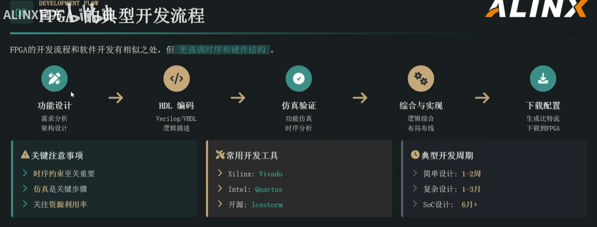
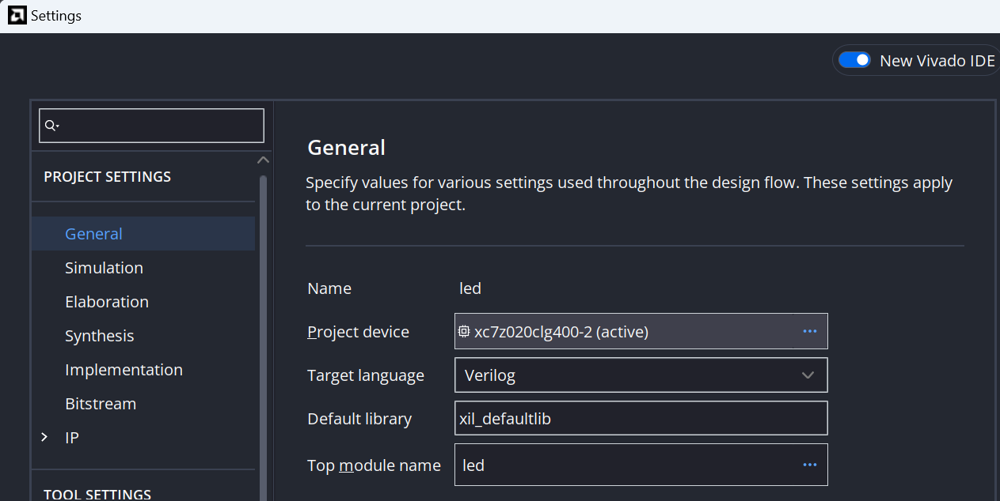
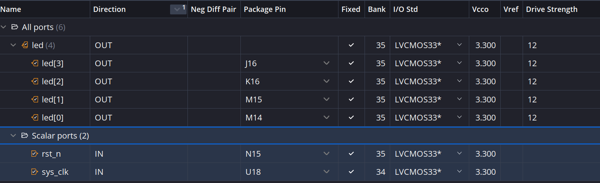

# AX7020 FPGA 零基础实验指南：LED 同步闪烁

> 本实验从 Vivado 新建工程开始，完成“编写 HDL → 行为仿真 → 添加约束 → 综合 → 实现 → 生成比特流 → JTAG 下载 → 实物验证”的完整流程。
>
> **实验效果：4 个 PL 用户 LED 同时亮、同时灭，每隔约 1 秒切换一次，完整亮灭周期约 2 秒。** 
>
> 开发板为 AX7020。实验只使用 PL，不需要PS。


## 1. 实验目标与基本原理

### 1.1 实验内容

- 从空白工程开始添加设计源文件、仿真源文件和约束文件。
- 理解计数器如何把 50 MHz 时钟转换为肉眼能观察到的亮灭变化。
- 检查仿真波形、综合结果、实现后的时序和 DRC。
- 通过板载 USB-JTAG 下载 `.bit`，验证 4 个 PL LED 同步闪烁。
- 使用 PL KEY1 复位，并保存完整的实验记录。

### 1.2 PS 与 PL

AX7020 的 Zynq 芯片包含 PS（处理器系统）和 PL（可编程逻辑）。本实验直接在 PL 中构建计数器和 LED 控制电路，使用板载 PL 晶振，不编写 PS 端 ARM 程序。

Verilog 描述的是硬件电路。计数器、比较逻辑和 LED 寄存器综合后在 FPGA 内工作，代码不是交给 ARM 按行执行的软件。

### 1.3 为什么 LED 每隔 1 秒切换

板载 PL 时钟是 50 MHz，即每个周期 20 ns。代码中的计数器从 `0` 数到 `49_999_999`，共经历 50,000,000 个周期，再把 4 位 LED 输出全部取反：

```text
一个时钟周期 = 1 / 50 MHz = 20 ns
切换间隔     = 50,000,000 × 20 ns = 1 s
```

计数器控制的是“什么时候更新 LED”，整个电路仍使用 50 MHz 时钟，没有另造一根慢时钟。

AX7020 的 PL LED **低电平点亮、高电平熄灭**，因此：

| 条件 / 输出 | 实际现象 |
| --- | --- |
| 按住复位，`rst_n = 0` | `led = 0000`，4 灯全亮，计数清零 |
| 松开复位后，计数未满 | 保持当前亮灭状态 |
| 计数达到终值后 | `led <= ~led`，4 灯同时切换亮灭 |
| `led = 0000` | 4 灯全亮 |
| `led = 1111` | 4 灯全灭 |


### 1.4 源文件作用

| 文件 | 用途 |
| --| --- | 
| `led.v` | 描述计数、复位和 LED 控制电路，最终综合为硬件 | 
| `vtf_led_test.v` | 在电脑里产生模拟时钟和复位，观察电路行为 | 
| `led.xdc` | 连接真实管脚，指定 I/O 电平与时钟周期 | 

上板下载的是后续生成的 `.bit` 文件。

行为仿真检查逻辑行为，实现后的静态时序分析检查实际布线延迟能否满足时钟要求，两者作用不同。



## 2. 实验前准备：软件、板卡与型号核对

### 2.2 Project Device：xc7z020clg400-2




### 2.3 本实验使用的硬件资源

| --- | --- | --- | --- |
| `sys_clk` | PL 50 MHz 晶振，PL_GCLK | U18，周期 20 ns | 第 15～16 页 |
| `rst_n` | PL KEY1，松开为 1，按下为 0 | N15 | 第 42～43 页 |
| `led[0]` | PL LED1，低电平亮 | M14 | 第 41～42 页 |
| `led[1]` | PL LED2，低电平亮 | M15 | 第 41～42 页 |
| `led[2]` | PL LED3，低电平亮 | K16 | 第 41～42 页 |
| `led[3]` | PL LED4，低电平亮 | J16 | 第 41～42 页 |
| I/O 电平 | 本实验涉及的 PL I/O | LVCMOS33，3.3 V | 第 13、15、41～42 页 |
| 下载连接 | 板载 USB-JTAG，FT232HL | USB 数据线 | 第 12～13 页 |
| 启动选择 | J13 | JTAG 对应针脚 | 第 14 页 |

本实验把 **PL KEY1** 用作自己设计电路的复位输入，不能用 PS 系统复位键代替。若板卡硬件版本与当前手册不同，应先核对对应版本的原理图。

## 3. 第一步：在 Vivado 新建 RTL 工程


2. 在向导首页点击 **Next**。
3. 在 **Project Name** 页填写：
   - Project name：`led`。
   - Project location：`E:/learn/FPGA/vivado_projects`，也可使用自己准备的英文路径。
   - 勾选 **Create project subdirectory**。
4. 点击 **Next**，在 **Project Type** 页选择 **RTL Project**。
5. 点击 **Next**，进入 **Default Part**，选择 **Parts** 页签，不要求提前安装 AX7020 Board File。
6. 搜索并选择 **`xc7z020clg400-2`**，检查芯片 `xc7z020`、封装 `clg400`、速度等级 `-2`，与已有工程一致。
7. 若搜索不到目标器件，先检查 Zynq-7000 器件支持是否安装；不要选择相近的其他封装代替。
8. 点击 **Next**，在汇总页核对工程位置、RTL Project 和 Part，再点击 **Finish**。

**目的**：建立管理源文件、约束和编译结果的工程，并告诉 Vivado 为哪一种 FPGA 生成电路。


## 4. 第二步：创建并填写设计文件 led.v

### 4.1 添加 Design Source


1. 点击 **Project Manager → Add Sources**，或 Sources 窗口中的 `+`。
2. 选择 **Add or create design sources → Next**。
3. 点击 **Create File**，File type 选 **Verilog**，File name 填 `led`，位置使用工程默认位置。
4. 点击 **OK → Finish**。
5. 若出现 **Define Module**，可直接确认；若提示没有定义端口，确认继续，随后用下面的完整代码替换模板。
6. 在 **Design Sources** 中双击 `led.v`，全选原内容，粘贴下面的代码，按 `Ctrl+S` 保存。
7. 右键 Design Sources 下的模块 `led`，选择 **Set as Top**。若已是顶层，只需确认其顶层标记。

**目的**：创建将被综合成真实硬件的顶层模块。顶层端口将在 XDC 中连接到板卡管脚。

**预期结果**：Design Sources 下出现 `led`，输入为 `sys_clk`、`rst_n`，输出为 4 位 `led`，没有语法错误标记。


### 4.2 原设计代码

```verilog
// 本实验使用 50 MHz 时钟，每个周期为 20 ns。
// AX7020 的 PL LED 低电平点亮：0000 为四灯全亮，1111 为四灯全灭。
// 本代码直接使用异步按键复位，未加入复位释放同步链和机械消抖。
// 实物测试时按住 PL KEY1 再松开，检查复位与重新计时的行为。
// 后续复杂设计需考虑复位同步和按键消抖；行为仿真不能证明硬件无亚稳态。
module led (
    // 接收板载 50 MHz 时钟，电路在每个上升沿更新时序逻辑。
    input sys_clk,
    // 低有效复位，连接 PL KEY1：按下为 0，松开为 1。
    input rst_n,
    // 四个位分别驱动 4 个 PL LED，保存当前亮灭状态。
    output reg [3:0] led
    );

// 32 位计数器，用于累计时钟周期，能够容纳终值 49,999,999。
reg[31:0] timer_cnt;

// 时钟上升沿触发更新；复位下降沿可异步触发，无需等待时钟沿。
// 下方 <= 是非阻塞赋值，同一时钟沿的条件判断使用更新前的寄存器值。
always@ (posedge sys_clk or negedge rst_n)
begin
    if (!rst_n)
    begin
        // 复位时 LED 输出全 0，四灯全亮，同时清零计数器。
        led <= 4'd0 ;
        timer_cnt <= 32'd0 ;
    end
    // 从 0 数到 49,999,999，共 50,000,000 个周期，切换间隔为 1 秒。
    else if(timer_cnt >= 32'd49_999_999)
    begin
        // 四位一起取反：0000 与 1111 交替，四灯同时亮灭。
        led <= ~led;
        // 切换后重新计数，使亮、灭各保持约 1 秒，完整周期约 2 秒。
        timer_cnt <= 32'd0;
    end
    else
    begin
        // 未计满时保持 LED 状态，计数器每个时钟周期加 1。
        led <= led;
        timer_cnt <= timer_cnt + 32'd1;
    end

end

endmodule
```

## 5. 第三步：创建仿真文件 vtf_led_test.v

### 5.1 添加 Simulation Source

**操作**

1. 点击 **Add Sources**。
2. 选择 **Add or create simulation sources → Next**，仿真集保持为 `sim_1`。
3. 点击 **Create File**，类型选 **Verilog**，名称填 `vtf_led_test`，点击 **OK → Finish**。
4. 如果出现 Define Module，确认后使用下面的完整代码替换模板。
5. 在 **Simulation Sources** 中双击文件，粘贴并保存。
6. 在 Simulation Sources 中右键 `vtf_led_test`，选择 **Set as Top**。
7. 确认仿真顶层为 `vtf_led_test`，设计顶层仍为 `led`。仿真层次中可以看到 `uut` 实例。

**目的**：在电脑中产生时钟和复位，先观察电路行为，再进行上板操作。

**预期结果**：仿真结构为 `vtf_led_test → uut (led)`；Testbench 不作为硬件综合顶层。

### 5.2 Testbench

```verilog
`timescale 1ns / 1ps

// Module Name: vtf led test

module vtf_led_test;
//Inputs
    reg sys_clk;
    reg rst_n ;
// Outputs
    wire [3:0] led;

// Instantiate the Unit Under Test (UUT)
led uut (
    .sys_clk(sys_clk),
    .rst_n(rst_n),
    .led(led)
    );

initial
begin
//Initialize Inputs
    sys_clk = 0;
    rst_n = 0 ;
    #1000;
    rst_n = 1;
end
//Create clock
always #10 sys_clk =~ sys_clk;

endmodule
```

`timescale 1ns / 1ps` 表示时间单位为 1 ns、精度为 1 ps。`#1000` 让复位保持 1000 ns；`always #10` 每 10 ns 翻转时钟，完整周期为 20 ns，对应 50 MHz。
## 6. 第四步：运行行为仿真并观察闪烁

### 6.1 启动仿真与添加信号

**操作**

1. 保存两个 `.v` 文件。
2. 点击 **Simulation → Run Simulation → Run Behavioral Simulation**。
3. 等待编译、展开和 XSim 启动。若失败，查看 Messages 和仿真日志中的第一条实际错误，修正后重试。
4. 在波形中查看 `sys_clk`、`rst_n`、`led`。若未显示，在 **Scope** 中选顶层，在 **Objects** 中选信号，右键 **Add to Wave Window**。
5. 在 Scope 中展开 `uut`，找到 `timer_cnt`，也添加到波形窗口。
6. 右键 `led`，将 **Radix** 设为 **Binary**；`timer_cnt` 可设为 **Unsigned Decimal**。
7. 先观察初始约 2 μs。可在仿真 Tcl Console 输入下面的命令；`restart` 会回到仿真起点。

**目的**：先确认时钟、复位和计数器启动正常，避免直接长时间运行后才发现输入错误。


### 6.2 运行足够长时间观察完整亮灭

**操作**

1. 在仿真 Tcl Console 输入：

```tcl
restart
run 2100 ms
```


放大到跳变附近，观察 `timer_cnt` 从终值清零。
- `led` 先保持 `0000`，随后变为 `1111`，再变回 `0000`。
- 相邻切换间隔为 1 秒，完整亮灭周期为 2 秒。
- 由于先保持复位 1000 ns、再等有效时钟沿，首次切换发生在复位释放后约 1 秒，而不是仿真绝对时间恰好 1 秒。
- 每次切换时，`timer_cnt` 清零并重新计数。

## 7. 第五步：设置管脚并生成 XDC

### 7.1 XDC 文件是干什么的

**XDC（Xilinx Design Constraints）是 Vivado 的设计约束文件**，用于保存电路与实际器件、板卡及时序要求之间的关系。本实验需要保存三类信息：

| 约束内容 | 要回答的问题 | 本实验的例子 |
| --- | --- | --- |
| 管脚位置 | 代码里的端口接到芯片哪个引脚？ | `sys_clk` 接 U18，`led[0]` 接 M14 |
| I/O 电平标准 | 端口使用什么电气标准？ | 6 个端口位均为 LVCMOS33，与板卡 3.3 V I/O 对应 |
| 时钟周期 | 工具应按多快的时钟检查电路延迟？ | `sys_clk` 为 50 MHz，周期 20 ns |

例如，`output reg [3:0] led` 只声明了 4 个输出，并没有说明它们接到 AX7020 的哪 4 个 LED。管脚约束将这些信号绑定到实际引脚；时钟约束则让工具知道电路每 20 ns 就要完成一次相应的时序传递。


使用图形窗口填写管脚和电平，再由 Vivado 保存生成 `led.xdc`。时钟设置将在第 9 节打开综合后设计时，通过另一个交互窗口追加到同一文件。


1. 点击 **RTL Analysis → Open Elaborated Design**，等待 RTL 展开完成。
2. 在工具栏的 **Layout** 布局下拉框中选择 **I/O Planning**。
3. 找到 **I/O Ports** 表格。若未显示，点击 **Window → I/O Ports**；必要时同时打开 **Package** 视图查看封装。
4. 展开 `led[3:0]` 总线，确认可以看到 `led[0]`～`led[3]`，以及 `sys_clk`、`rst_n`，共 6 个端口位。


I/O Ports 中能看到端口名、方向、**Package Pin** 和 **I/O Std** 等列；未设置的位置可能为空，电平可能显示 DEFAULT。若某列被隐藏，可调整表格宽度或在列标题菜单中显示该列。

### 7.2 在表格中填写管脚和电平

| Port Name | Direction | Package Pin | I/O Std | 对应硬件 |
| --- | --- | --- | --- | --- |
| `sys_clk` | Input | U18 | LVCMOS33 | PL 50 MHz 晶振 |
| `rst_n` | Input | N15 | LVCMOS33 | PL KEY1，低有效复位 |
| `led[0]` | Output | M14 | LVCMOS33 | PL LED1 |
| `led[1]` | Output | M15 | LVCMOS33 | PL LED2 |
| `led[2]` | Output | K16 | LVCMOS33 | PL LED3 |
| `led[3]` | Output | J16 | LVCMOS33 | PL LED4 |

6 个端口位均显示指定管脚和 LVCMOS33；Package 视图中可定位相应引脚。这里填写的是芯片的 BGA 管脚号，不是板上连接器的排针序号。

### 7.4 保存设置，生成 led.xdc

1. 在设计视图中点击 **File → Constraints → Save**，或点击 **Save Constraints** 工具栏按钮。
2. 第一次保存时，如果弹出 **Save Constraints** 窗口，在工程默认约束目录下填写文件名 **`led.xdc`**，确认保存并加入当前约束集 `constrs_1`。
3. 在 **Sources → Constraints → constrs_1** 中检查生成的 `led.xdc`。若工程已有该文件，保存到它即可；如需选择目标，可右键该文件设为 **Set as Target Constraint File**。
4. 可以双击文件查看工具生成的文本，用于核对保存结果；本流程中的设置在交互窗口完成，无需粘贴约束代码。
5. 若文件里暂时只有管脚和电平信息，这是本阶段的正常结果。第 9 节会继续通过窗口设置并保存 20 ns 时钟约束。

**结果**：Constraints 下出现 `led.xdc`，保存了 6 个端口位的管脚与电平

## 8. 第六步：打开 RTL 分析，检查电路结构


1. 打开 Elaborated Design。
2. 若提示语法或连接错误，返回源文件修复；查看结构时可把 Layout 切换回 **Default Layout**。
3. 打开 **Schematic**，查看顶层端口、计数器、比较逻辑与 LED 寄存器。
4. 确认设计顶层是 `led`，没有把 `vtf_led_test` 当成硬件顶层。

## 9. 第七步：运行综合，并通过窗口设置时钟约束

### 9.1 首次综合，打开综合后设计

1. 保存源文件与 XDC，点击 **Synthesis → Run Synthesis**。
2. 在 **Launch Runs** 中使用本机可承受的并行任务数，点击 **OK**。
3. 等待完成；若失败，查看 **Messages** 或 **Design Runs → synth_1** 的日志，先处理第一条实际错误。
4. 成功后选择 **Open Synthesized Design**。
5. 打开 **Reports → Report Utilization**，查看 LUT、FF 等资源使用。
6. 在 **Window → I/O Ports** 或对应 I/O 视图中，核对 U18、N15、M14、M15、K16、J16 及 LVCMOS33。

`synth_1` 显示完成，可打开综合网表和利用率报告。

### 9.2 在 Create Clock 对话框中设置 50 MHz 时钟

1. 保持 **Open Synthesized Design** 已打开，点击 **Window → Timing Constraints**；也可从 Flow Navigator 的综合后设计节点选择 **Edit Timing Constraints**。
2. 在 Timing Constraints 窗口左侧展开 **Clocks**，双击 **Create Clock**，或选中该项后点击 `+`，打开创建主时钟的对话框。
3. 按下表填写。源对象用旁边的 `…` / 浏览按钮选择，在端口列表中找到输入端口 `sys_clk`，加入选中项后确认。

| 窗口字段 | 本实验填写值 | 含义 |
| --- | --- | --- |
| Clock name | `sys_clk` | 时钟约束的名称 |
| Source objects / 源对象 | 顶层输入端口 `sys_clk` | 时钟实际进入 FPGA 的端口 |
| Period (ns) | `20.000` | 50 MHz 对应的周期 |
| Rise at (ns) / 上升沿 | `0.000` | 每周期的上升沿位置 |
| Fall at (ns) / 下降沿 | `10.000` | 每周期的下降沿位置，形成 50% 占空比 |

4. 确认源对象确实是 `sys_clk` 端口，再点击 **OK**；若编辑表格后显示 **Apply**，点击应用。此处定义输入主时钟，不选择生成时钟，也不创建没有源端口的虚拟时钟。
5. 在 Create Clock 表格中确认出现名称 `sys_clk`、周期 20 ns、源对象为该输入端口的一行。如果打开的是已有工程，并且这条约束已经存在，直接核对，避免重复添加。
6. 点击 **File → Constraints → Save**，将新时钟设置保存到第 7 节生成的 `led.xdc`。若提示选择目标文件，选择当前约束集中的该文件。

### 9.3 让综合使用已保存的完整约束

1. 保存约束后关闭综合后设计视图，重新点击 **Run Synthesis**，让本次综合读取完整 XDC。若提示原结果过期或需要重置运行，确认重新运行。
2. 综合完成后再次 **Open Synthesized Design**，打开 Timing Constraints，确认 `sys_clk` 的周期仍为 20 ns。
3. 再检查一次 I/O Ports 中的 6 个管脚和电平，以及资源利用率报告，然后继续实现。


**结果**：重新打开设计后，管脚、电平和时钟设置均保留，综合成功。

## 10. 第八步：运行实现 Implementation 并检查时序

1. 点击 **Implementation → Run Implementation**。
2. 若提示执行前置步骤，确认执行；等待实现完成。
3. 选择 **Open Implemented Design**。
4. 打开 **Reports → Timing → Report Timing Summary**，生成时序报告。
5. 核对 `sys_clk` 周期为 20 ns，查看内部受约束路径的 Setup（建立时间）与 Hold（保持时间）结果。
6. 查看 **Report DRC** 与 Messages，定位 Error 和 Critical Warning。
7. 单独记录异步复位、LED 输出等相关提示。不要用“实现完成”代替对未约束路径和复位释放问题的分析。

**目的**：把网表放到具体芯片资源位置并完成布线，再根据实际延迟检查电路能否按 50 MHz 工作。

**结果**：`impl_1` 完成；内部受约束路径满足时序要求，没有阻止比特流生成的 DRC 错误。常用指标中，WNS ≥ 0、TNS = 0 对应所报告的建立时间检查通过；同时检查 WHS ≥ 0、THS = 0 等保持时间结果。


## 11. 第九步：生成比特流 led.bit

1. 点击 **Program and Debug → Generate Bitstream**。
2. 若提示运行尚未完成的前置步骤，确认执行。
3. 等待生成完成；成功后可选择 **Open Hardware Manager**。
4. 在工程目录中确认本次 `.bit` 已生成：

```text
led/
├── led.xpr
├── led.srcs/       ← 设计、仿真和约束文件
└── led.runs/
    └── impl_1/
        └── led.bit       ← 下载到 FPGA 的比特流
```

## 12. 第十步：连接开发板并设置 JTAG 模式

## 13. 第十一步：在 Hardware Manager 下载

1. 在 Vivado 点击 **Open Hardware Manager**。
2. 点击 **Open target → Auto Connect**。
3. 等待扫描，在 Hardware 窗口中确认出现 Zynq/FPGA 器件
4. 右键 FPGA 器件，选择 **Program Device**。
5. 在 **Bitstream file** 中选择当前工程本次生成的 `led.runs/impl_1/led.bit`。
6. 点击 **Program**，等待配置完成，确认没有下载错误。
7. 按住一次 **PL KEY1** 再松开，让设计从明确的计数初始状态开始。

**结果**：配置成功；按住 KEY1 时 4 灯全亮，松开后约 1 秒全灭，再约 1 秒全亮，持续交替。

## 14. 对照已有工程，使用 ILA 观察内部信号

基础实验完成。以下使用ILA（Integrated Logic Analyzer，片内逻辑分析仪），可以在 FPGA 实际运行时抓取 `timer_cnt` 和 LED 输出。ILA 抓到的是板上的真实信号。
### 14.1 从新建工程添加调试观测的入口

如只需完成同步闪烁，可以跳过。若要给从零创建的工程增加 ILA，可在**综合后、实现前**操作，不改本文 Verilog 逻辑：

1. 打开 **Open Synthesized Design**。
2. 在 **Netlist** 中找到需要观察的 LED 和计数器网络，右键 **Mark Debug**。优化可能改变网络名称或合并等价位，以实际保留的网表为准，不要照抄失效网络名。
3. 点击 **Set Up Debug**，按向导添加这些网络，确认采样时钟来自 50 MHz 的 `sys_clk`。
4. 把采样深度设为 1024，核对汇总后完成向导。
5. 使用 **File → Constraints → Save** 保存生成的调试约束，再运行实现和比特流生成。
6. 检查生成的 `.bit` 和 `.ltx`，后续下载使用同一次构建的文件。

Debug 窗口出现 ILA 核，重新生成后得到可配对使用的比特流与探针信息。实际资源使用会高于没有 ILA 的基础实验。

### 14.2 下载并触发一次计数清零

1. 下载后刷新设备，打开识别到的 ILA 仪表面板。若未出现，检查配对文件、50 MHz 时钟是否运行及调试连接提示。
2. 在 Waveform 中把 LED 设为二进制、计数器设为无符号十进制。
3. 在 **Trigger Setup** 点击 `+` 添加计数器探针，比较条件设为 `==`，Radix 选无符号十进制，Value 填 `49999990`。
4. 保持基本触发，采样深度设为 1024，触发位置可放在窗口中间，并保持每周期连续采样。
5. 点击 **Run Trigger**，松开 PL KEY1，等待计数达到条件并上传波形；若一直按住 KEY1，计数为 0，不会触发。
6. 放大触发点后约 10 个时钟周期的位置，检查计数达到终值、随后清零及 LED 同时取反的关系。

在终值附近看到 `timer_cnt` 清零、`led_OBUF` 在 `0000` 与 `1111` 之间切换。